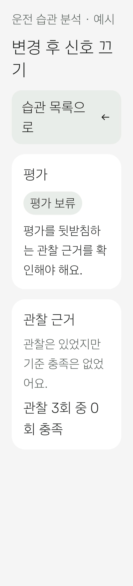
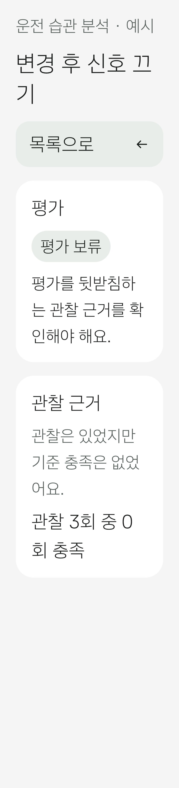

# Compose Preview 실제 렌더링 검토 — 2026-11-12

대상 앱 소스는 `321e5571a8920cdab7c225c1d1de650f2571d4d1`입니다. GitHub PR 검증용 merge commit `739a0a9652a9fa3f8f1153117479adcafe7505f4`에서 실제 앱 컴포넌트·리소스·테마·Mock 공급원을 렌더링했습니다. 아래 PNG는 렌더러 원본이며 생성형 이미지나 재구성한 목업이 아닙니다.

- [Compose Preview Review 실행](https://github.com/HaHandle/DriveAssistant/actions/runs/43171354974): 96개 렌더링 성공, 실패·오류 0개.
- [직전 실행](https://github.com/HaHandle/DriveAssistant/actions/runs/43170192010): 수정 전 이미지와 비교 근거. 앱 소스 `f300255`, merge commit `a5498c0`.
- [manifest.json](manifest.json): 96개 파일의 원래 경로·픽셀 크기·SHA-256. 전체 PNG와 JUnit 보고서는 실행 페이지의 `compose-preview-review-43171354974` 아티팩트에 있습니다.
- 로컬 앱 검증: assembleDebug, testDebugUnitTest, lintDebug, assembleDebugAndroidTest 성공. JVM 73개 실패·오류·건너뜀 0개, Lint 오류 0개·기존 경고 19개. 문구만 바뀌어 변경 없는 JVM 작업은 Gradle 결과를 재사용했습니다.

## 렌더링 범위와 직접 확인한 범위

| 대상 | 사례 | 구성 | 이미지 수 |
| --- | --- | --- | --- |
| 습관 상세 | 정상 네 항목, 근거 누락, 관찰 0회, 미충족, 미평가, 근거 없는 성공 | 주간·야간·320dp/글자 200%·넓은 영문 | 36 |
| 점수 대시보드 | 세 기간, 부분 누락, 기록 없음, 전부 미측정, 0점 하나, 0/100점 | 주간·야간·320dp/글자 200%·영문 | 32 |
| 앱 상태 | 로딩·빈 기록·오류·정상·부분 누락·티어 예시·최고 티어 예시 | 주간·야간·520dp/글자 200%·넓은 영문 | 28 |

96개는 **이미지 생성 검사** 결과입니다. 사람이 모든 이미지를 승인한 기준선이 아닙니다. 아래 대표 5개를 직접 확인했고, 수정 후 바뀐 습관 이미지 2개를 다시 확인했습니다. 변경되지 않은 세 이미지의 SHA-256은 직전 실행과 같습니다. manifest의 `reviewed: false`는 전체 승인과 자동 픽셀 회귀 검사를 아직 도입하지 않았다는 뜻입니다.

| 실제 확인 이미지 | 확인 결과 |
| --- | --- |
| [습관 상세·320dp/200%](habit-large-text.png) | 평가 보류와 관찰 후 0회 충족이 구분됨. 긴 문장은 줄바꿈하며 내용이 표시됨. 복귀 문구 수정 확인 |
| [점수·320dp/200%](score-large-text.png) | 기간 선택이 세로로 전환되고 날짜·미측정·비교 불가 문구가 표시됨. 그래프는 스크롤 아래에 있어 이 초기 뷰포트에서 전부 보이지 않음 |
| [앱·야간·부분 누락](app-night.png) | 어두운 표면에서 미측정과 측정 2회·미측정 2회 안내를 읽을 수 있음. 하단 탐색 표시 |
| [습관·주간·관찰 3회 중 0회 충족](habit-day.png) | 복기할 항목과 실제 횟수가 표시되고 근거 없음으로 바뀌지 않음 |
| [점수·주간·0/100 경계](score-day.png) | 두 측정점이 0/100 축에 맞고 +100점 비교가 표시됨. 미측정으로 취급하지 않음 |

## 발견한 문제와 수정

320dp/글자 200%에서 `습관 목록으로`의 마지막 `로`만 다음 줄에 남았습니다. 기존 버튼 구조·크기·접근성 동작을 유지하며 한국어 `habit_back` 문구만 `목록으로`로 줄였습니다. 수정 커밋은 `321e557`입니다. 같은 사례의 재렌더링에서 한 줄로 표시되는 것을 확인했습니다.

| 수정 전 | 수정 후 |
| --- | --- |
|  |  |

## 코드 검토와 남은 검증

- #16의 12개 JVM 사례와 표시 모델을 대조했습니다. 원본 status·횟수를 보존하고 관찰 누락·0회·미충족을 구분합니다. 임시 UI 표시 규칙이며 평가 기준·서버 계약의 확정이 아닙니다.
- #17은 현재 Ready 데이터에서 종류 키를 다시 조회하며 삭제·중복 키에서 상세를 유지하지 않습니다. 차량 제한과 모션 비허용 분기는 전환 컨테이너를 우회합니다. 이는 코드 검토이며 새 기기 실행 증빙은 아닙니다.
- #15의 그래프는 전체 `window`를 AnimatedContent 대상으로 사용합니다. 데이터 갱신과 기간 선택을 구분한 모션, 진행 중인 페이드에서 모션 끄기·백그라운드 전환 시 즉시 중단되는지는 실행 확인이 남았습니다. 정적인 PNG로 통과 처리하지 않습니다.
- 기기 UI 테스트는 APK 컴파일만 확인했습니다. 뒤로 가기·상태 복원·스크롤·차량 제한 전환, TalkBack 읽기 순서, 실제 디스플레이 크기·터치 영역은 미검증입니다.
- 영문·나머지 사례도 렌더링은 성공했지만 이번 대표 이미지 검토에 포함하지 않았습니다. 팀원이 전체 아티팩트를 확인해야 합니다. Pleos 공식 인증·실차 검수 완료를 의미하지 않습니다.

Windows에서는 Android CLI 빌드 보조 실행 파일과 Layoutlib DLL이 실행 제어 정책에 차단됐습니다. 정책을 변경하지 않고 Ubuntu CI에서 렌더링했습니다. 에뮬레이터를 부팅하지 않았습니다.
